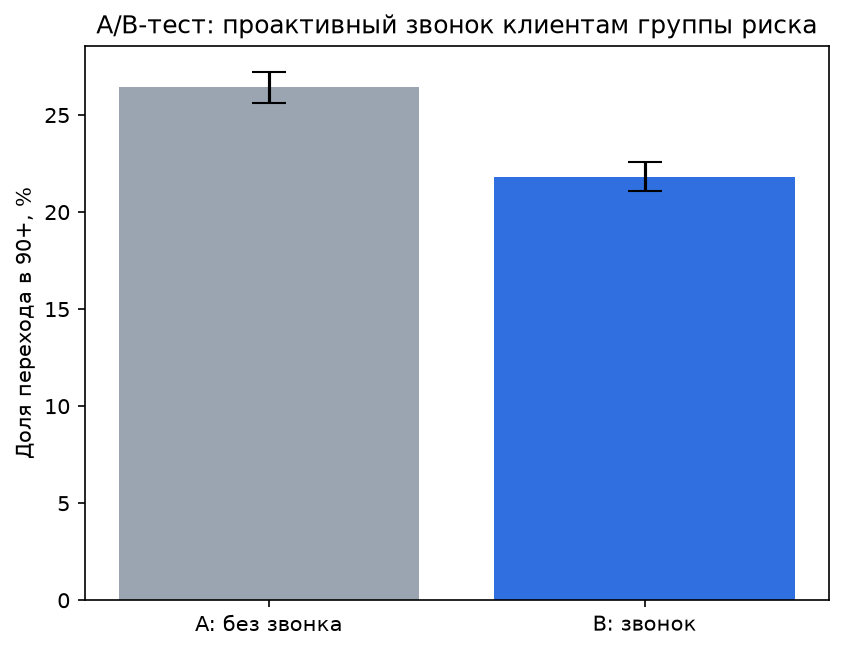
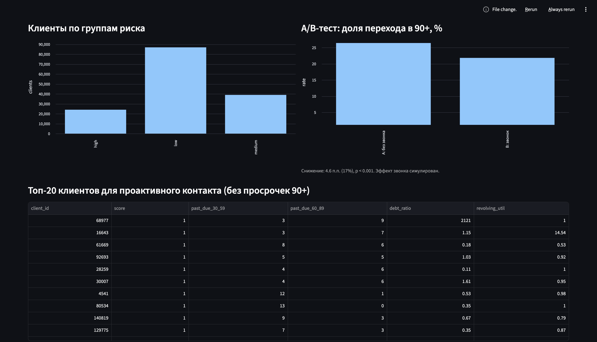
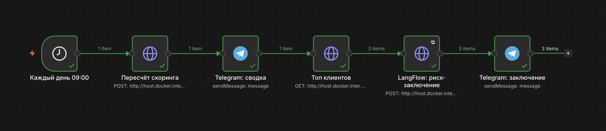
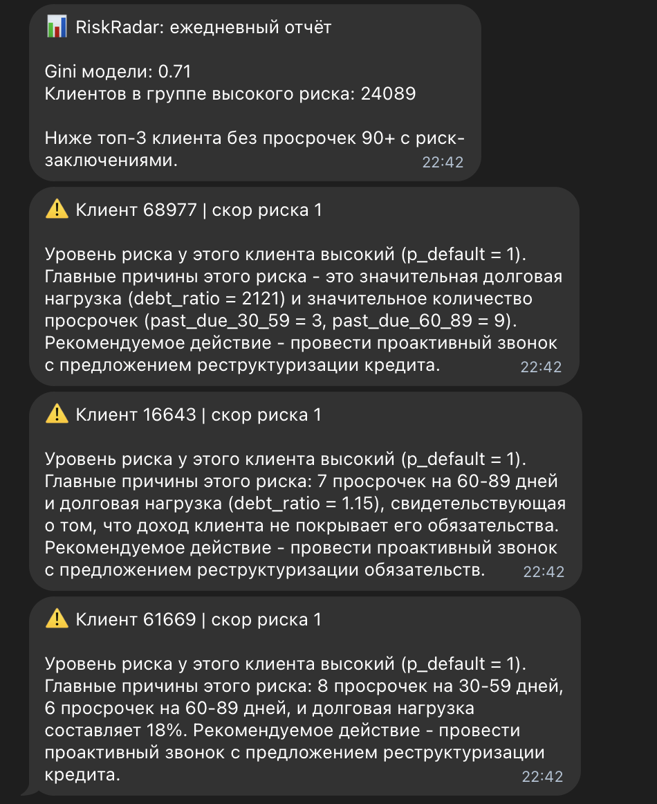

# RiskRadar — система раннего выявления кредитного риска

Пет-проект по риск-аналитике: строю скоринговую модель дефолта и через A/B-тест проверяю, снижает ли ранний контакт с клиентами группы риска переход в просрочку 90+ дней. Ежедневный мониторинг портфеля автоматизирован: алерты в Telegram и риск-заключения от LLM.

**Стек:** Python · SQL (PostgreSQL) · n8n · LangFlow · Ollama · scikit-learn · statsmodels · Streamlit · Docker

---

## Проблема

Банк присваивает клиенту статус проблемного на 90-й день просрочки. К этому моменту клиент три месяца не платит, долг уходит в работу взыскания, а банк формирует под него резервы. Я предлагаю находить рискованных клиентов **на раннем этапе** и проверить, помогает ли ранний контакт удержать их от выхода в 90+ дней.

## Решение

Система каждый день:
1. пересчитывает риск дефолта для каждого клиента;
2. отбирает клиентов с высоким риском, у которых ещё **нет** просрочек 90+;
3. генерирует по каждому короткое заключение (причины + рекомендуемое действие) через локальную LLM;
4. отправляет сводку риск-менеджеру в Telegram.

---

## Гипотеза и A/B-тест

> Если клиентам из группы риска (скор модели ≥ 0.6) заранее позвонить и предложить реструктуризацию, доля перешедших в просрочку 90+ снизится как минимум на 20% относительно контрольной группы.

- **Группа A (контроль):** обычный процесс, без контакта
- **Группа B (тест):** проактивный звонок с предложением реструктуризации
- **Распределение:** случайное, 50/50, среди клиентов группы риска
- **Основная метрика:** доля клиентов, перешедших в просрочку 90+ дней
- **Защитная метрика:** доля клиентов, согласившихся на реструктуризацию
- **H0:** доля перехода в 90+ в группах A и B одинакова
- **H1:** в группе B доля ниже
- **Параметры:** α = 0.05, мощность 80%, размер выборки рассчитан заранее

> Реальных данных эксперимента нет, поэтому эффект в группе B симулирован: исходы клиентов взяты из датасета, а предполагаемый эффект звонка задан явно. Цель — показать дизайн эксперимента: расчёт выборки, рандомизацию, анализ и интерпретацию результатов.

### Результат

| Показатель | Значение |
|---|---|
| Клиентов в группе риска | 24 089 |
| Нужный размер выборки на группу | 786 |
| Доля 90+ в группе A | 26.4% |
| Доля 90+ в группе B | 21.8% |
| Относительное снижение | 17.4% |
| p-value | < 0.001 |
| 95% доверительный интервал разницы | [3.5; 5.7] п.п. |

**Вывод:** H0 отвергается (p < 0.001): проактивный звонок снижает переход в 90+ на 4.6 п.п. (с 26.4% до 21.8%). Снижение чуть ниже целевых 20% из-за случайного дисбаланса групп до эксперимента. Рекомендация: пилот на ~1 600 клиентах, затем масштабирование на всю группу риска с контролем доли реструктуризаций.



---

## Архитектура

```
OpenML (Give Me Some Credit)
      │  src/get_data.py
      ▼
PostgreSQL (dim_client, fact_credit_snapshot, fact_scores, v_kpi)
      │
      ▼
Python: скоринг (логистическая регрессия) ── FastAPI /score, /high-risk
      ▲
      │  ежедневно 09:00
     n8n ──► топ клиентов high risk ──► LangFlow + Ollama (риск-заключение) ──► Telegram

Streamlit-дашборд ◄── PostgreSQL
```

---

## Модель

| Метрика | Значение |
|---|---|
| ROC AUC | 0.855 |
| Gini | 0.71 |
| Клиентов в зоне high risk | 24 089 |

Логистическая регрессия выбрана за интерпретируемость: коэффициенты можно объяснить кредитному комитету.

---

## Качество данных

Проверки в [`sql/02_checks.sql`](sql/02_checks.sql) нашли: 20% пропусков дохода, служебные коды просрочек 96/98, выбросы использования лимитов и одного клиента младше 18 лет. Все случаи обработаны в `src/score.py`.

---

## Бизнес-анализ и жизненный цикл ПО

Проект выполнен по модели Waterfall. Подробно — в [docs/business_analysis.md](docs/business_analysis.md).

| Этап | Артефакт |
|---|---|
| Анализ | Стейкхолдеры, AS-IS / TO-BE, user stories |
| Требования | Функциональные и нефункциональные требования |
| Проектирование | Схема БД, архитектура |
| Разработка | SQL, Python, n8n, LangFlow |
| Тестирование | Проверки качества данных, A/B-тест, метрики модели |
| Внедрение | Документация, демо |

---

## Демо

| Дашборд | Workflow n8n | Алерт в Telegram |
|---|---|---|
|  |  |  |

> LLM-заключение — подсказка риск-менеджеру, а не решение: маленькая локальная модель может ошибаться в арифметике, поэтому цифры всегда берутся из базы.

---

## Структура репозитория

```
├── data/                  # датасет (не в git)
├── docs/                  # бизнес-анализ, скриншоты
├── sql/
│   ├── 01_schema.sql      # таблицы и KPI-views
│   └── 02_checks.sql      # проверки качества данных
├── notebooks/
│   └── 02_ab_test.ipynb   # дизайн и анализ A/B-теста
├── src/
│   ├── get_data.py        # загрузка датасета с OpenML
│   ├── load.py            # загрузка CSV в Postgres
│   ├── score.py           # обучение и скоринг
│   ├── api.py             # FastAPI для n8n
│   └── dashboard.py       # Streamlit
├── n8n/workflow.json
├── langflow/flow.json
└── requirements.txt
```

---

## Как запустить

1. Установить зависимости и скачать данные:
   ```bash
   pip install -r requirements.txt
   python src/get_data.py
   ```
2. Поднять сервисы:
   ```bash
   docker run -d --name pg -e POSTGRES_PASSWORD=risk -e POSTGRES_DB=risk -p 5432:5432 postgres:16
   docker run -d --name n8n -p 5678:5678 -v n8n_data:/home/node/.n8n n8nio/n8n
   ```
3. Загрузить данные и создать схему:
   ```bash
   python src/load.py
   docker exec -i pg psql -U postgres -d risk < sql/01_schema.sql
   python src/score.py
   ```
4. Запустить API: `cd src && uvicorn api:app --host 0.0.0.0 --port 8000`
5. Установить Ollama (ollama.com) и скачать модель: `ollama pull qwen2.5:3b`
6. Запустить LangFlow (`langflow run`) и импортировать `langflow/flow.json`
7. Импортировать `n8n/workflow.json` в n8n, указать токен Telegram-бота, Chat ID и API-ключ LangFlow
8. Дашборд: `streamlit run src/dashboard.py`

---

## Что дальше

- Калибровка вероятностей модели
- Мониторинг дрейфа данных (PSI)
- Сравнение с градиентным бустингом

---

**Автор:** Ян Пищевский · [GitHub](https://github.com/YanPishchevskii)
